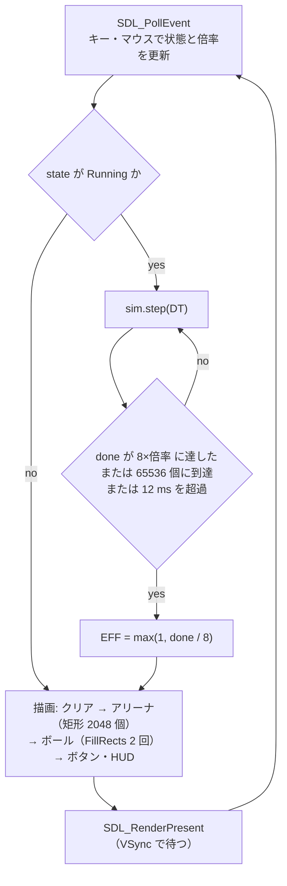
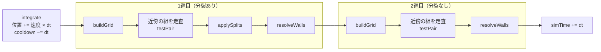
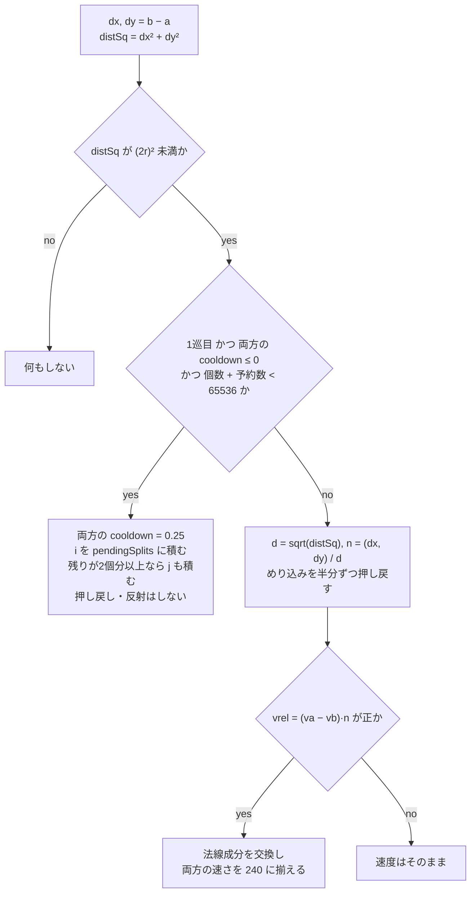

<h1 align="center">Ball Split — 実装詳細</h1>

本資料は、Ball Split が**コードの上でどう作られているか**を、プログラムの構成、データとメモリ、格子、衝突、分裂、描画、検証の順に、実際のコードを引きながら説明する。制作の意図、工夫の要点、測定結果は[作品説明資料](https://github.com/mocaluna0117/ball-split/blob/main/docs/portfolio/PORTFOLIO.md)にまとめてある。そこで導いた式や方針（時間刻み 1/480 秒、一様格子、12 ミリ秒の上限、$\mathbf{v}-2(\mathbf{v}\cdot\mathbf{n})\mathbf{n}$ など）は前提として扱い、本資料ではその一段下の実装に絞る。

> [!NOTE]
> ソースは `src/` の4ファイルだけである。ファイル名は GitHub 上のファイルへのリンクにし、コードの場所は関数名で示す。座標はすべて論理座標（px）で、y 軸は下向きである。

---

## 1. プログラムの構成

### ファイルと役割

| ファイル | 役割 | 主な関数・型 |
|---|---|---|
| [Simulation.h](https://github.com/mocaluna0117/ball-split/blob/main/src/Simulation.h) | 定数・ボールの型・`Simulation` の宣言。インクルードは `<vector>` `<random>` `<cstddef>` だけで、**SDL に依存しない** | `Ball` `Simulation`、`BALL_R` `DT` などの定数 |
| [Simulation.cpp](https://github.com/mocaluna0117/ball-split/blob/main/src/Simulation.cpp) | 物理のすべて | `reset` `step` `integrate` `buildGrid` `resolveCollisions` `testPair` `applySplits` `resolveWalls` `diagnose` |
| [main.cpp](https://github.com/mocaluna0117/ball-split/blob/main/src/main.cpp) | SDL、メインループ、入力、描画、HUD、検証モード | `main` `runHeadless` `drawButton` |
| [Font.h](https://github.com/mocaluna0117/ball-split/blob/main/src/Font.h) | 5×7 のビットマップフォント（ASCII 32〜90） | `fontGlyph` `drawText` |

依存は main.cpp → `Simulation` の一方向だけである。画面側は `getBalls()` が返す `const std::vector<Ball>&` をコピーせずに読んで描く。物理側は描画を知らないので、`runHeadless` は `SDL_Init` を呼ばずに同じ `Simulation` を回せる（7章）。ボールの状態を書き換える公開メンバは `reset` と `step` だけである。

### メインループ（1フレーム）

[main.cpp](https://github.com/mocaluna0117/ball-split/blob/main/src/main.cpp) の `main` は「イベント処理 → 物理 → 描画 → `SDL_RenderPresent`」を1周とする。レンダラーは `SDL_RENDERER_PRESENTVSYNC` を付けて作ってあり、フレームの間隔は垂直同期で決まる。物理の部分は次のとおりである。

```cpp
constexpr int   BASE_SUBSTEPS   = 8;       // 60fps x 8 = 480 ステップ/秒 = 実時間
constexpr double FRAME_BUDGET   = 0.012;   // 1 フレームで物理に使ってよい秒数
...
    const int target = BASE_SUBSTEPS * speedScale;
    ...
    while (done < target) {
        sim.step(DT);
        ++done;
        if (sim.isFinished()) { state = AppState::Finished; break; }
        // 重くなってきたら途中で打ち切る。落ちる代わりに倍率が下がる。
        if ((double)(SDL_GetPerformanceCounter() - t0) / freq > FRAME_BUDGET) break;
    }
    effectiveScale = done / BASE_SUBSTEPS;
```

- 1フレームのステップ数の目標は $8s$ である（$s$ は速度倍率 1〜512。起動時 16、`--shot` 時 512）。最大 4096 ステップ/フレームになる。
- **経過時間を溜め込むアキュムレータ方式ではない。** ステップ数を倍率から直接決めるので、1ステップの結果はフレームレートに左右されない。一方で「倍率1で実時間」という対応（$8 \times \tfrac{1}{480} = \tfrac{1}{60}$ 秒）は、VSync で 60fps に揃うことを前提にしている。
- 打ち切りの判定は**1ステップ終えるごと**なので、1フレームの物理時間は「12 ミリ秒＋1ステップぶん」まで伸びうる。どれだけ重くても最低1ステップは進む。
- 画面の EFF は $\max(1, \lfloor \mathit{done}/8 \rfloor)$ である（直後の行で下限を1にしている）。



### 1ステップ

[Simulation.cpp](https://github.com/mocaluna0117/ball-split/blob/main/src/Simulation.cpp) の `step` は、`integrate` 1回と「`resolveCollisions` → `resolveWalls`」の2巡でできている。1巡目だけ `splitEnabled = true` にする。



- `integrate` は $\mathbf{p} \leftarrow \mathbf{p} + \mathbf{v} \Delta t$ だけである。力が働かず衝突の間は等速直線運動なので、この更新に積分の誤差は無い。
- `buildGrid` は `resolveCollisions` の先頭で呼ばれるので、**格子は1ステップに2回、ゼロから作り直す**。
- 2巡目も最後に `applySplits` を呼ぶが、予約が無いので何もしない。

---

## 2. データの持ち方とメモリ

### ボールは構造体の配列（AoS）

```cpp
struct Ball {
    float x, y;          // 中心座標
    float vx, vy;        // 速度。大きさは常に SPEED
    float cooldown;      // 0 より大きい間は分裂しない
};
...
std::vector<Ball> balls;
```

- 1個 **20 バイト**（`float` 5個、詰め物なし）で、65536 個で 1,310,720 バイト（1.25 MiB）になる。
- **半径・質量・色はボールごとに持たない。** 半径は全ボール共通の定数 `BALL_R = 0.9`、質量は暗黙に等しい（4章の式が等質量を前提にする）。色は `cooldown > 0` かどうかで描画時に決める（6章）。
- 成分ごとの配列（SoA）にはしていない。`testPair` は1組について位置・速度・猶予をすべて読み書きするので、AoS だと1個ぶんが連続した 20 バイトに収まる。SIMD やスレッドは使っていない。
- 速さは常に `SPEED = 240` である（`randomVelocity` と `normalizeSpeed` が 240 にし、鏡面反射は大きさを変えない）。ボールごとに変わるのは実質的に向きだけである。

### 配列と確保のタイミング

`Simulation` の配列の確保は `reset` に集めてある。`reset` が呼ばれるのは、起動時、リセット（R キー・RESET ボタン）、初期個数の変更時だけである。描画用の配列は `main` がループに入る前に確保する。

| 配列 | 場所 | 確保 | 上限時の大きさ | 用途 |
|---|---|---|---|---|
| `balls` | Simulation | `reserve(65536)` | 1.25 MiB | ボール本体 |
| `cellHead` | Simulation | `assign(GRID_DIM*GRID_DIM, -1)` | 198,916 要素（約 777 KiB） | マスごとの鎖の先頭 |
| `nextBall` | Simulation | `reserve(65536)` | 256 KiB | 鎖の次のボール |
| `occupiedCells` | Simulation | `reserve(65536)` | 最大 256 KiB | ボールが入ったマスの番号 |
| `pendingSplits` | Simulation | `reserve(4096)` | 予約の数による | 分裂の予約 |
| `normalRects` / `freshRects` | main.cpp | `reserve(65536)` / `reserve(4096)` | 1 MiB（`SDL_FRect` は 16 バイト） | 描画用の矩形 |

**ステップの途中で `balls` が確保し直されることはない。** 分裂の予約は、個数と予約数の合計が 65536 に届かないときだけ通り、残りが1個分なら1個だけ予約する（5章）。`applySplits` が足すのは予約1件につき1個なので、適用後の個数は 65536 を超えず、`reserve(65536)` の容量に収まる。`nextBall.resize(balls.size())` も同じ容量の中で済み、`occupiedCells` の要素数はボール数を超えない。

`pendingSplits` と `freshRects` は 4096 で予約しているだけなので、超えた回には `std::vector` が伸びる。ただし `clear()` は容量を保つので、確保し直しは最大値を更新したときだけ起きる。

### 後片付け

- ソースに `new` / `delete` / `malloc` は出てこない。メモリはすべて `std::vector` が持ち、`main` のローカル変数 `sim` のデストラクタが解放する。
- SDL の資源は作った逆の順に破棄する（`SDL_DestroyRenderer` → `SDL_DestroyWindow` → `SDL_Quit`）。ウィンドウやレンダラーの作成に失敗した場合も、それまでに作ったものを破棄してから終わる。`--shot` の `SDL_Surface` は保存直後に `SDL_FreeSurface` する。
- `drawText` は関数内の `static std::vector<SDL_FRect>` を `clear()` して使い回し、文字列ごとの確保を避けている。

---

## 3. 空間分割（一様格子）

### マスの大きさと格子の寸法

```cpp
constexpr float CELL_SIZE = BALL_R * 2.0f;
constexpr int   GRID_DIM  = (int)(2.0f * ARENA_R / CELL_SIZE) + 2;
```

マスの一辺は $s = 2r = 1.8$ px、格子は $\lfloor 2R/s \rfloor + 2 = \lfloor 444.4 \rfloor + 2 = 446$ マス四方で、アリーナを囲む正方形の左上 $(500-400, 548-400) = (100, 148)$ から $446 \times 1.8 = 802.8$ px を覆う。半径を変えると格子も自動で決まり直す。

一辺を直径にする理由は次の式である。2個が接触しているなら各軸の差も直径未満なので、マス番号の差は各軸で1以下になる。

$$
|\mathbf{p}_i - \mathbf{p}_j| < 2r = s
\quad\Longrightarrow\quad
|x_i - x_j| < s
\quad\Longrightarrow\quad
\left\lfloor \frac{x_i - x_0}{s} \right\rfloor - \left\lfloor \frac{x_j - x_0}{s} \right\rfloor \in \lbrace -1, 0, 1 \rbrace
$$

したがって相手は自分を中心とする 3×3 マスの中にしかいない。$s$ を直径より小さくすると2マス先まで見る必要が出て、大きくすると接触しない組まで調べることになる。

マス番号は `cellCoords` で求め、`[0, 445]` に押し込める。衝突の解決は壁より前に走り、ボールがわずかにはみ出していることがあるためである。なお、アリーナの面積 $\pi R^2 \approx 502{,}655$ px² はマス約 155,000 個ぶんなので、65536 個が一様に散らばれば1マスあたり平均約 0.42 個になる。

### 配列2本の鎖を毎回作り直す

`buildGrid` が格子の構築のすべてである（[Simulation.cpp](https://github.com/mocaluna0117/ball-split/blob/main/src/Simulation.cpp)）。

```cpp
void Simulation::buildGrid()
{
    for (int c : occupiedCells) cellHead[c] = -1;   // 使ったマスだけ戻す
    occupiedCells.clear();

    nextBall.resize(balls.size());

    for (size_t i = 0; i < balls.size(); ++i) {
        int cx, cy;
        cellCoords(balls[i].x, balls[i].y, cx, cy);
        int c = cy * GRID_DIM + cx;

        if (cellHead[c] == -1) occupiedCells.push_back(c);

        nextBall[i] = cellHead[c];
        cellHead[c] = (int)i;
    }
}
```

- **配列で表した単方向リスト（鎖）への先頭挿入**である。マスごとに `std::vector` を持つ方式と違ってマスの数ぶんの動的確保が無く、カウンティングソートのように `balls` 自体を並べ替えることもしない。
- 先頭に挿入するので、鎖の中はボール番号の降順になる（[作品説明資料](https://github.com/mocaluna0117/ball-split/blob/main/docs/portfolio/PORTFOLIO.md)4章の図の `7 → 3 → 0` がこれである）。
- 後片付けは `occupiedCells` に控えたマスだけを `-1` に戻す。手間はボールの数 $n$ に比例し、マスの総数 198,916 には比例しない。全マスを `-1` で埋めるのは `reset` の `assign` だけである。

### 近傍の走査（半分の近傍）

`resolveCollisions` は、ボールが入っているマスだけを `occupiedCells` の順に回る。

```cpp
static const int NEIGHBORS[4][2] = { {1, 0}, {-1, 1}, {0, 1}, {1, 1} };

for (size_t k = 0; k < occupiedCells.size(); ++k) {
    int c  = occupiedCells[k];
    ...

    // 同じマスの中のペア。鎖の自分より後ろだけを見る
    for (int i = cellHead[c]; i != -1; i = nextBall[i])
        for (int j = nextBall[i]; j != -1; j = nextBall[j])
            testPair((size_t)i, (size_t)j);

    // 隣のマスとのペア
    for (int n = 0; n < 4; ++n) {
        ...
        if (cellHead[nc] == -1) continue;
        for (int i = cellHead[c]; i != -1; i = nextBall[i])
            for (int j = cellHead[nc]; j != -1; j = nextBall[j])
                testPair((size_t)i, (size_t)j);
    }
}
```

周囲8マスへのずれは $\pm(1,0)$、$\pm(-1,1)$、$\pm(0,1)$、$\pm(1,1)$ の4組に分けられる。`NEIGHBORS` は各組から片方（右・左下・下・右下）だけを取っている。隣り合う2マス A、B のずれを $\mathbf{d} = B - A$ とすると、$\mathbf{d}$ と $-\mathbf{d}$ のちょうど一方がこの4つに入るので、**その組は A か B の片方からだけ1回調べられる**。同じマスの中は `j = nextBall[i]` から始めるので、各組を1回だけ見る。空のマスは `occupiedCells` に入らず、空の隣は `cellHead[nc] == -1` で飛ばす。

### この走査の性質

- **その場で書き換えながら順に解く。** `testPair` は位置と速度をすぐ書き換えるので、同じ巡の後の組はそれを見て判定する。結果は走査の順番に依存する。
- **巡の途中では格子を更新しない。** 押し戻しでボールが隣のマスへ移っても、その巡の間は元のマスに登録されたままである。次の `buildGrid`（2巡目か次のステップ）で正しいマスに入り直す。
- **走査の順番は空間の並びではない。** `occupiedCells` は「そのマスに最初に入ったボールの番号」の順に並び、`balls` の並びも分裂で末尾に足した順である。メモリを空間の順に読む工夫（マス順への並べ替え）は、[作品説明資料](https://github.com/mocaluna0117/ball-split/blob/main/docs/portfolio/PORTFOLIO.md)7章で次の改善候補として挙げている。

---

## 4. 衝突の判定と応答

1組の処理はすべて `testPair` にある（[Simulation.cpp](https://github.com/mocaluna0117/ball-split/blob/main/src/Simulation.cpp)）。同じマスの組からも、隣のマスとの組からも、これを呼ぶ。



平方根は、接触していて、しかも分裂しない組でだけ計算する。

### めり込みの解消

$\mathbf{n} = (\mathbf{p}_b - \mathbf{p}_a)/d$ を a から b への単位法線、めり込み量を $\delta = 2r - d$ として、2個を $\delta/2$ ずつ反対向きに動かす。

$$
\mathbf{p}_a \leftarrow \mathbf{p}_a - \tfrac{\delta}{2} \mathbf{n}, \qquad
\mathbf{p}_b \leftarrow \mathbf{p}_b + \tfrac{\delta}{2} \mathbf{n}
$$

係数をかけて少しずつ戻すのではなく、**1回でちょうど接する距離まで戻す**（`overlap * 0.5f` ずつ）。中心がほぼ一致して法線が決まらないとき（$d \le 10^{-4}$）は $\mathbf{n} = (1, 0)$、$d = 0$ として、直径ぶん引き離す。

### 速度の交換（等質量の弾性衝突）

法線方向に大きさ $J$ の撃力が働くとすると、質量が等しいので

$$
\mathbf{v}_a' = \mathbf{v}_a - J\mathbf{n}, \qquad \mathbf{v}_b' = \mathbf{v}_b + J\mathbf{n}
$$

で運動量は自動的に保存される。これを弾性衝突の条件（法線方向の相対速度が反転する）に代入すると、$J$ が決まる。

$$
(\mathbf{v}_a' - \mathbf{v}_b')\cdot\mathbf{n} = -(\mathbf{v}_a - \mathbf{v}_b)\cdot\mathbf{n}
\quad\Longrightarrow\quad
J = (\mathbf{v}_a - \mathbf{v}_b)\cdot\mathbf{n}
$$

コードの `vrel` がこの $J$ である。

```cpp
// 法線方向の相対速度。正なら近づいている
float vrel = (a.vx - b.vx) * nx + (a.vy - b.vy) * ny;
if (vrel > 0.0f) {
    a.vx -= vrel * nx;
    a.vy -= vrel * ny;
    b.vx += vrel * nx;
    b.vy += vrel * ny;

    normalizeSpeed(a.vx, a.vy);
    normalizeSpeed(b.vx, b.vy);
}
```

- 速度を変えるのは `vrel > 0`（近づいている）ときだけで、離れつつある組（`vrel ≤ 0`）は押し戻すだけである。
- 交換のあと `normalizeSpeed` で $\mathbf{v} \leftarrow 240 \mathbf{v}/|\mathbf{v}|$ と速さだけを揃え直す（$|\mathbf{v}| \le 10^{-4}$ なら何もしない）。この時点で運動量・エネルギーの保存は崩れる。そうした理由は[作品説明資料](https://github.com/mocaluna0117/ball-split/blob/main/docs/portfolio/PORTFOLIO.md)7章にある。

### 壁

`resolveWalls` は全ボールについて、アリーナ中心からの距離 $d$ を限界 $R - r = 399.1$ と比べる。

```cpp
    float d  = std::sqrt(dx * dx + dy * dy);
    if (d <= limit) continue;
    ...
    b.x = ARENA_CX + nx * limit;
    b.y = ARENA_CY + ny * limit;

    float vn = b.vx * nx + b.vy * ny;
    if (vn > 0.0f) {
        b.vx -= 2.0f * vn * nx;
        b.vy -= 2.0f * vn * ny;
    }
```

位置は中心から半径方向に、限界の円の上へ射影する。鏡面反射は速さを変えないので `normalizeSpeed` は呼ばない。壁の判定は2乗ではなく距離そのもので比べるので、はみ出していないボールにも平方根を1回ずつ計算している。

### すり抜けとめり込みの深さ

接触は「その時点で重なっているか」だけで判定しており、移動の経路を調べる連続的な判定（スイープ）はしていない。すり抜けを防いでいるのは時間刻みの大きさである。

1ステップの移動量は1個あたり $240 \times \tfrac{1}{480} = 0.5$ px、2個の距離が縮むのは最大 1.0 px である。前のステップの終わりに離れていた（$d \ge 2r = 1.8$）組は、次に重なりを検出した時点でも

$$
d \ge 1.8 - 1.0 = 0.8 > 0
$$

を満たす。つまり**1ステップのうちに中心同士がすれ違わない**ので、$\mathbf{n}$ は必ず正しい側を向き、押し戻しは2個を元の側へ離す。移動によるめり込みは最大 1.0 px（直径の約 56%）である。ただしこれは速度による移動だけの話で、密集した所では他の組の押し戻しでも動かされるため、重なりは完全には消えない。その残り方を測るのが7章の検証である。

---

## 5. 分裂

### 予約

分裂は `testPair` の中で「予約」し、走査が終わってから `applySplits` で「適用」する2段階になっている。

```cpp
size_t reserved = balls.size() + pendingSplits.size();
size_t room     = reserved < MAX_BALLS ? MAX_BALLS - reserved : 0;
bool   ready    = splitEnabled && a.cooldown <= 0.0f && b.cooldown <= 0.0f;

if (ready && room >= 1) {
    // ここで猶予を立てることが、同じパスでの二重予約の防止も兼ねる
    a.cooldown = SPLIT_COOLDOWN;
    b.cooldown = SPLIT_COOLDOWN;
    pendingSplits.push_back(i);
    // 個数は 2 ずつ増えるので、初期個数が奇数だと上限の 1 個手前で
    // 止まり、上限に届かない。残りが 1 個分なら片方だけ分裂させる。
    if (room >= 2) pendingSplits.push_back(j);
    return;                       // 分裂するので反射はしない
}
```

- 予約した瞬間に `cooldown = 0.25` を立てるので、**同じボールが1つの巡で2回予約されることはない**。そのボールが同じ巡で別のボールにも触れていれば、その組は通常の衝突として押し戻し・反射される。
- 予約した組は押し戻しも反射もしない。親はこのあと子に置き換わり、子の周りの重なりは同じステップの2巡目で解消される。
- 猶予の 0.25 秒は 120 ステップにあたる。`integrate` が毎ステップ $\Delta t$ ずつ減らす（0 で止めない）。

### 適用

```cpp
void Simulation::applySplits()
{
    for (size_t idx : pendingSplits) {
        Ball parent = balls[idx];      // 参照ではなくコピー

        float axis = angleDist(rng);   // 割れる向きは毎回変える
        float ox = std::cos(axis) * BALL_R;
        float oy = std::sin(axis) * BALL_R;

        Ball c1, c2;
        c1.x = parent.x + ox;  c1.y = parent.y + oy;
        c2.x = parent.x - ox;  c2.y = parent.y - oy;
        randomVelocity(c1.vx, c1.vy);
        randomVelocity(c2.vx, c2.vy);
        c1.cooldown = SPLIT_COOLDOWN;
        c2.cooldown = SPLIT_COOLDOWN;

        balls[idx] = c1;               // 親のスロットを子 1 で上書き
        balls.push_back(c2);           // 子 2 は末尾に追加
    }
}
```

子の位置は、一様乱数の角度 $\theta \in [0, 2\pi)$ を使って

$$
\mathbf{c}_{1,2} = \mathbf{p} \pm r (\cos\theta, \sin\theta)
$$

とする。2個の子の中心間距離は $2r$ で、ちょうど接する距離に置かれる。速度は2個それぞれ独立に、ランダムな向きで大きさ 240 である。親の速度は使わない。

**配列から要素を消す処理が無い**ので、番号の詰め直しも格子からの削除も要らない。格子は次の巡の `buildGrid` で作り直すので、子2を末尾に足すだけで済む。

### 何を保ち、何を保たないか

| 量 | 分裂での扱い | 根拠のコード |
|---|---|---|
| 個数 | 接触1回で 2 → 4（+2）。上限の直前だけ +1 になることがある | `testPair` が2個を予約し、`applySplits` が1件につき1個足す |
| 半径 | 子も同じ 0.9 px | 半径は定数 `BALL_R` |
| 速さ | 子も 240 px/秒 | `randomVelocity` |
| 位置の重心 | 子2個の中点は親の位置に一致する | 子は親から ± 同じずれに置かれる |
| 運動量 | 保たない（子の向きは独立な乱数） | `randomVelocity` |
| 面積（質量） | 保たない（分裂のたびに総面積が増える） | 半径が一定 |

### 上限と個数の偶奇

上限までの残り（`room` = 65536 −「いまの個数＋予約済み」）を見て予約する。残りが2個分以上なら2個とも、1個分なら接触した片方だけを予約し、0 なら予約しない。超える予約は最初から通さないので、個数が 65536 を超えることはない。終了判定は `isFinished()` の `balls.size() >= MAX_BALLS` である。

個数は普段2ずつ増えるので、偶奇が変わらない。片方だけの予約が無いと、初期個数が奇数（`--initial 255` や、`--initial 100` から ← で 50 → 25）のときは個数が 65535 で止まり、`isFinished()` がいつまでも真にならなかった。片方だけの予約はこの最後の1個のためのもので、初期個数が偶数なら起きない。2・3・25・255・256・8192 から始めて、どれもちょうど 65536 で止まり、検証モードの判定が PASS になることを確かめている。

### 初期配置

分裂の子とは別に、開始時の配置は `reset` が行う。中心からの距離は $\rho = \mathit{spread}\cdot\sqrt{u}$（$u$ は 0〜1 の一様乱数）で、[作品説明資料](https://github.com/mocaluna0117/ball-split/blob/main/docs/portfolio/PORTFOLIO.md)5章の $\rho = R\sqrt{u}$ の $R$ を、個数 $n$ に応じた範囲に置き換えた形である。

$$
\mathit{spread} = \min\left(\max\left(\tfrac{R}{2}, 8r\sqrt{n}\right), R - r\right)
$$

初期個数が 2〜512 なら $R/2 = 200$ px、1024 と 2048 なら $8r\sqrt{n}$、4096 以上なら $R - r$ で頭打ちになる。$8r\sqrt{n}$ の区間では、撒く円に対するボールの面積の割合が $n\pi r^2 / \pi(8r\sqrt{n})^2 = 1/64$（約 1.6%）で一定になる。

初期のボールにも `cooldown = 0.25` を与え、まれに重なって置かれても、置いた瞬間には分裂せずに押し戻しで離れるようにしている。

---

## 6. 描画（SDL2）

### 論理座標

`SDL_RenderSetLogicalSize` で論理 1000×1000 に固定し、ウィンドウは 900×900（`SDL_WINDOW_ALLOW_HIGHDPI`）で作る。**物理の座標をそのまま描画の座標に使う**ので、変換の計算は無い。アリーナの中心 $(500, 548)$ は上部の UI のぶん下げてある。マウスの位置は `SDL_RenderWindowToLogical` で論理座標に直してからボタンと当てる。

### ボールの一括描画

[main.cpp](https://github.com/mocaluna0117/ball-split/blob/main/src/main.cpp) の描画は、毎フレーム矩形の配列を作り直して、色ごとに1回ずつ `SDL_RenderFillRectsF` に渡す。

```cpp
normalRects.clear();
freshRects.clear();
for (const Ball& b : sim.getBalls()) {
    SDL_FRect r{ b.x - drawR, b.y - drawR, drawR * 2.0f, drawR * 2.0f };
    if (b.cooldown > 0.0f) freshRects.push_back(r);   // 分裂したて
    else                   normalRects.push_back(r);
}
if (!normalRects.empty()) {
    SDL_SetRenderDrawColor(renderer, 110, 210, 140, 255);
    SDL_RenderFillRectsF(renderer, normalRects.data(), (int)normalRects.size());
}
// freshRects も同様に黄色 (245, 225, 120) で 1 回
```

- 1個のボールは一辺 $2 \times \mathit{drawR}$ の**正方形1枚**で、円は描かない。
- `SDL_RenderFillRectsF` は1回の呼び出しに1色しか使えないので、`cooldown > 0`（分裂したて、黄）とそれ以外（緑）の2本の配列に振り分ける。**ボールが何個でも、描画の呼び出しは最大2回**である。
- 表示上の半径は $\mathit{drawR} = \max(r, 5/\sqrt{n})$ である。$5/\sqrt{n} > 0.9$ となるのは $n \le 30$ のときだけで、そのあいだだけ大きく描く。当たり判定の `BALL_R` は変えない。

### アリーナと文字も矩形で描く

- アリーナの円は、円周上に 2×2 px の正方形を 2048 個並べた配列をループの前に一度だけ作り、毎フレーム `SDL_RenderFillRectsF` 1回で描く。Direct3D で折れ線が欠けたための対処である（[作品説明資料](https://github.com/mocaluna0117/ball-split/blob/main/docs/portfolio/PORTFOLIO.md)5章(4)）。
- 文字は [Font.h](https://github.com/mocaluna0117/ball-split/blob/main/src/Font.h) の `drawText` が、7 行 × 下位 5 ビットのビットマップの立っているビットごとに矩形を積み、**文字列1つにつき1回**の `SDL_RenderFillRectsF` で塗る。
- `--shot` は `SDL_RenderPresent` の前に `SDL_RenderReadPixels` で読み出し、`SDL_SaveBMP` で保存して終了する。

---

## 7. 検証の仕組み

### 検証モード（`--headless`）

`runHeadless`（[main.cpp](https://github.com/mocaluna0117/ball-split/blob/main/src/main.cpp)）は SDL を初期化せず、`Simulation` だけを次の順に回す。

1. `reset` し、半径・初期個数・上限・格子の寸法を表示する
2. `isFinished()` まで `step(DT)` を繰り返す。個数が報告値（初期個数から2倍ずつ）に達するたびに、個数・シミュレーション時間・実時間・ステップ数を1行出す。シミュレーション時間が 20000 秒を超えたら打ち切る
3. 満杯のまま 100 ステップ回し、`std::chrono::steady_clock` で1ステップの平均を測る。上限のため分裂は起きないので、65536 個での格子・衝突・壁の手間だけを測ることになる
4. `diagnose` を呼び、PASS / CHECK を出す

### `diagnose` の判定基準

`diagnose`（[Simulation.cpp](https://github.com/mocaluna0117/ball-split/blob/main/src/Simulation.cpp)）は、`step` を終えた状態（画面に出る状態）について次を数える。近傍の走査は `resolveCollisions` と同じ格子・同じ4方向で行う。

| 項目 | 数え方 | 許容幅 |
|---|---|---|
| アリーナの外 | 中心からの距離が $(R - r) + 0.01$ を超えるボール | 0.01 px |
| 重なっている組 | 中心間距離が $2r - 0.01$ 未満の組 | 0.01 px |
| 最も深い重なり | 上の組のうち $2r - d$ の最大値 | — |

判定は次の3つがすべて成り立てば PASS、そうでなければ CHECK である。

$$
n = 65536 \quad\wedge\quad \text{outside} = 0 \quad\wedge\quad \text{maxOverlap} < 1.0 \text{ px}
$$

1.0 px という基準の意味と決め方は[作品説明資料](https://github.com/mocaluna0117/ball-split/blob/main/docs/portfolio/PORTFOLIO.md)6章にある。

### 測定結果（作品説明資料からの引用）

[作品説明資料](https://github.com/mocaluna0117/ball-split/blob/main/docs/portfolio/PORTFOLIO.md)6章によると、Windows 11（Core i5-1335U）では 65536 個で1ステップ **7.24 ms**、アリーナ外 0、最も深い重なり 0.27 px で PASS した。macOS（Apple M2）の16回では、最も深い重なりが 0.21〜0.55 px だった。本資料で測り直した値ではない。

### リポジトリに無いもの

- 単体テストのフレームワーク、テスト用のファイル、`assert` は無い。正しさの確認は上の検証モードが担う。
- Makefile・CMakeLists.txt・build_windows.sh にサニタイザの設定は無い。[作品説明資料](https://github.com/mocaluna0117/ball-split/blob/main/docs/portfolio/PORTFOLIO.md)5章(3)の `leaks`、AddressSanitizer、UndefinedBehaviorSanitizer による検査に使ったビルド設定は、リポジトリには残っていない。
- 乱数は `std::mt19937` を `std::random_device` で初期化しており、種を指定する手段が無いので、同じ実行を再現できない（作品説明資料7章の改善候補）。

---

## 8. 本資料について

本資料の数値や設定は、コード（2b15d72時点）から引いている。5章の上限の扱いは、その後に直した「初期個数が奇数だと終わらない」不具合の修正を反映している。測定結果は作品説明資料6章からの引用である。
